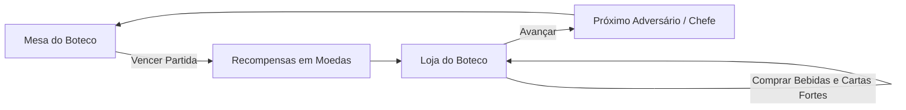

# MVP-Truco-Tecnologias-Emergentes

# 🃏 Truco Argentino: Deckbuilder de Boteco (Web PoC)

Uma prova de conceito (PoC) web completa que une a malandragem e as regras autênticas do **Truco Argentino** com a progressão viciante de um **Roguelike Deckbuilder** (inspirado em *Balatro*, ambientado em botecos portenhos).

---

## 🚀 Como Executar o Jogo

Como o projeto é construído em módulos modernos ES6 e HTML5/CSS Pixel Art sem dependências de compilação pesadas, você pode rodá-lo instantaneamente:

### Opção 1: Via Python (já instalado)
Abra o terminal na pasta do projeto e execute:
```bash
python -m http.server 3000
```
Em seguida, abra seu navegador em: **`http://localhost:3000`**

### Opção 2: Via Vite / Node.js
```bash
npx vite --port 3000 --open
```
ou
```bash
npm run dev
```

### Opção 3: Extensões de Editor
Se você usa VS Code ou Cursor, basta clicar com o botão direito em `index.html` e selecionar **"Open with Live Server"**.

---

## 🎮 Regras & Mecânicas do Jogo

### 1. Hierarquia de Força do Truco Argentino (da mais forte para a mais fraca)
1. **1 de Espadas** (*Ancho de Espadas / Macho*) — Força 14
2. **1 de Bastos** (*Ancho de Bastos / Hembra*) — Força 13
3. **7 de Espadas** (*Siete Bravo*) — Força 12
4. **7 de Oros** (*Siete Bello*) — Força 11
5. **Todos os 3** (Espadas, Bastos, Copas, Oros) — Força 10
6. **Todos os 2** — Força 9
7. **1 de Copas e 1 de Oros** (*Anchos Falsos*) — Força 8
8. **Todos os 12** (*Reys*) — Força 7
9. **Todos os 11** (*Caballos*) — Força 6
10. **Todos os 10** (*Sotas*) — Força 5
11. **7 de Copas e 7 de Bastos** (*Sietes Comuns*) — Força 4
12. **Todos os 6** — Força 3
13. **Todos os 5** — Força 2
14. **Todos os 4** (as mais baixas) — Força 1

> 💡 *Dica:* Na mesa do jogo, você pode ativar a opção **"Dicas de Força ★"** para ver a classificação de cada carta na sua mão!

### 2. A Mão e as Vazas
- Cada jogador recebe 3 cartas.
- Disputam-se 3 vazas. Quem vencer 2 vazas ganha a mão.
- **Resolução de Pardas (Empates):**
  - Empate na 1ª vaza: quem vencer a 2ª ganha a mão.
  - Empate na 2ª vaza: quem levou a 1ª ganha imediatamente.
  - Empate em todas as vazas: o jogador que é o **Mano** leva a mão.

### 3. O Canto do Truco
- Mão normal sem truco: vale **1 ponto**.
- **¡TRUCO!**: vale **2 pontos** (se recusado: 1 ponto).
- **¡RETRUCO!**: vale **3 pontos** (se recusado: 2 pontos).
- **¡VALE CUATRO!**: vale **4 pontos** (se recusado: 3 pontos).

### 4. O Envido e a Flor
- Ocorre antes da primeira carta ser jogada.
- Duas cartas do mesmo naipe somam **20 + valor nominal** (figuras 10, 11 e 12 valem 0 para Envido).
- **Flor**: se você receber 3 cartas do mesmo naipe, cante FLOR para garantir 3 pontos automáticos!

---

## 🏆 O Ciclo Roguelike & Loja de Boteco (`instruct.md`)



### 🃏 Curingas (Jokers) Disponíveis
- **Mate Amargo:** Vencer uma mão com Truco aceito concede +$5 moedas extras.
- **Gaucho Astuto:** Seus 4s passam a ter Força 5 (superam os 5s e empatam com as Sotas).
- **Grito Porteño:** Adversários têm +30% de chance de correr (No Quiero) dos seus Trucos.
- **Ouro de San Telmo:** Ganhe +$2 moedas cada vez que jogar uma carta de Oros na mesa.
- **Flor de Buenos Aires:** Seu cálculo de Envido sempre recebe +4 pontos de bônus.
- **Parda da Sorte:** Sempre que uma vaza empatar, ganhe +$3 moedas.
- **La Mano de Dios:** Na 3ª vaza, figuras (10, 11, 12) ganham +5 de força de Truco!
- **Bife de Chorizo:** Inicie as partidas com +2 pontos de vantagem no placar.
- **Tango Dramático:** Vencer na 3ª vaza concede +1 ponto extra no placar da partida.
- **Garçom Camarada:** 25% de desconto em todas as compras e serviços da Loja.

### 🧹 Purificação do Baralho
Na Loja, você pode pagar para **remover cartas fracas** (como 4s e 5s) do seu baralho permanente de 40 cartas. Quanto menor o baralho, maior a chance de receber Ases de Espadas/Bastos e Sietes bravos em cada mão!

---

## 🎨 Assets & Sprite Sheet
- Cartas renderizadas diretamente da sprite `8BitDeck_BaralhoEspanhol.png` (grade 13x4, 142x190px por célula) com nitidez `image-rendering: pixelated`.
- Efeitos sonoros 8-bit sintetizados via **Web Audio API** nativa (sem necessidade de carregar arquivos externos de áudio).

